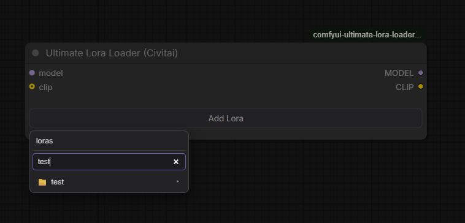
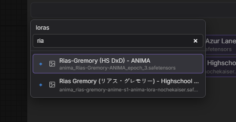
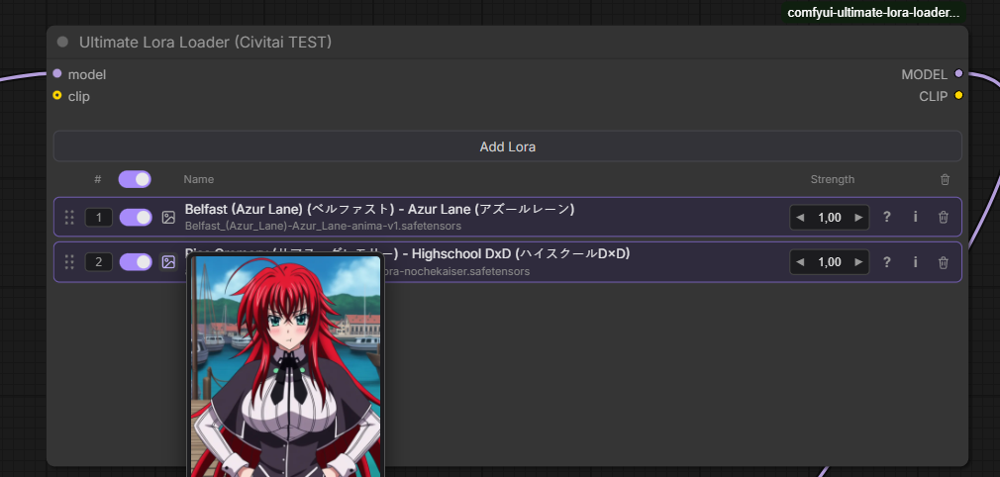
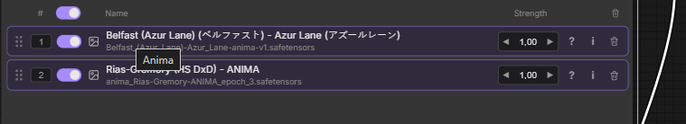
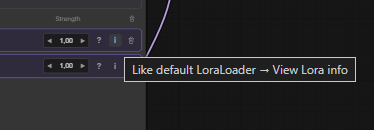
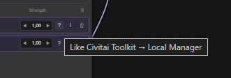

# Ultimate Lora Loader (Civitai)

[](LICENSE)
[](https://github.com/StoneZol/comfyui-ultimate-lora-loader-civitai-toolkit-supported/issues)

Specialized ComfyUI LoRA stack loader based on [Ultimate Lora Loader](https://github.com/WaitWut/comfyui-ultimate-lora-loader).

This is **not** an upstream contribution / PR track — it’s a separate, narrowly focused product: the original folder-browser LoRA stack, plus Civitai-aware naming, cover previews, dual info buttons, and a tighter Add Lora browser. Bug reports and feature requests go **here**, not to the original repo.

**Bug reports:** [github.com/StoneZol/…/issues](https://github.com/StoneZol/comfyui-ultimate-lora-loader-civitai-toolkit-supported/issues)

Everything from the base node still works (folder browser, optional CLIP, drag-to-reorder, split strengths, missing-file detection, …). This build adds extras on top:

1. **Two per-row info buttons**
    - **`?`** — [Civitai Toolkit](https://github.com/BAIKEMARK/ComfyUI-Civitai-Toolkit) **local DB** popup (gallery-style: name, tags, triggers from indexed scan)
    - **`i`** — [ComfyUI-Custom-Scripts](https://github.com/pythongosssss/ComfyUI-Custom-Scripts) **View Lora info** dialog (the same one as RMB on a default LoraLoader: preview images, Civitai link, trained words, …)
2. **Civitai dual naming + cover preview + base model** — when Toolkit has the LoRA indexed: Civitai title + filename; hover image icon for cover; **Base** column in Add Lora; on stack rows hover name → base model tooltip only
3. **Add Lora browser UX** — sticky search (~¾ width, always visible while scrolling), autofocus on open, filter in the **current** folder (filename / folder / Civitai name / base model), Tab stays inside the popup (Esc closes)

Tested with **Civitai Toolkit 4.1.3** and **ComfyUI-Custom-Scripts 1.2.5**.













## What this build adds

| Feature                   | Behavior                                                                                                                                                 |
| ------------------------- | -------------------------------------------------------------------------------------------------------------------------------------------------------- |
| `?` on each row           | Soft dependency on **Civitai Toolkit**. Opens Toolkit’s local-index info popup.                                                                          |
| `i` on each row           | Soft dependency on **ComfyUI-Custom-Scripts (pysssss)**. Opens the full **View Lora info** dialog (preview / Civitai link / keywords).                   |
| Dual name                 | Toolkit-indexed LoRAs show **Civitai title** (top) + **filename** (bottom) on stack rows and in Add Lora. Without Toolkit / not indexed → filename only. |
| Base model                | **Add Lora:** separate Base column. **Stack rows:** hover name → `base_model` tooltip only (no path/name duplicate).                                     |
| Cover preview             | Image icon before the name; hover shows Toolkit cover (stack rows + Add Lora list). Dimmed when no cover.                                                |
| Filter in **Add Lora**    | Filters the **current** folder only (filename / subfolder / Civitai title / base model). Cleared on drill-down / breadcrumb.                             |
| Sticky search + autofocus | Search bar pinned (~¾ popup width) while the list scrolls; focused when the popup opens or you change folder.                                            |
| Keyboard in popup         | **Tab / Shift+Tab** cycle inside the popup (search → list → breadcrumbs). **Enter / Space** open/select. **Esc** closes.                                 |

For base-node behavior (install notes, CLIP optional, missing-file UX, etc.) see the [original README](https://github.com/WaitWut/comfyui-ultimate-lora-loader#readme).

## Requirements

The loader node itself runs standalone. Dual naming / cover preview enrich from Toolkit when present (soft). For the info buttons you also need:

| Button                     | Plugin                               | Tested version | Repo                                                                                            |
| -------------------------- | ------------------------------------ | -------------- | ----------------------------------------------------------------------------------------------- |
| **`?`** (+ names / covers) | Civitai Toolkit                      | **4.1.3**      | [BAIKEMARK/ComfyUI-Civitai-Toolkit](https://github.com/BAIKEMARK/ComfyUI-Civitai-Toolkit)       |
| **`i`**                    | **ComfyUI-Custom-Scripts** (pysssss) | **1.2.5**      | [pythongosssss/ComfyUI-Custom-Scripts](https://github.com/pythongosssss/ComfyUI-Custom-Scripts) |

Install both into `ComfyUI/custom_nodes` if you want the full experience. Without Custom Scripts, **`i`** will fail with an alert; without Toolkit, **`?`** / dual names / covers degrade gracefully (filename-only, no cover).

## Install

```bash
cd ComfyUI/custom_nodes
git clone https://github.com/StoneZol/comfyui-ultimate-lora-loader-civitai-toolkit-supported.git

# also needed for the info buttons / Civitai names & covers:
git clone https://github.com/BAIKEMARK/ComfyUI-Civitai-Toolkit.git
git clone https://github.com/pythongosssss/ComfyUI-Custom-Scripts.git
```

Or copy this folder into `ComfyUI/custom_nodes/` and **fully restart ComfyUI**.

> Don’t install two copies with the **same** `js/ullc/config.json` ids — duplicate API routes will crash startup. Keeping the original [Ultimate Lora Loader](https://github.com/WaitWut/comfyui-ultimate-lora-loader) next to this one is fine.

### Multiple copies side-by-side

Edit **`js/ullc/config.json`** in each copy so these fields are unique:

| Field               | What it controls                                                 |
| ------------------- | ---------------------------------------------------------------- |
| `extension_name`    | frontend `registerExtension` id                                  |
| `node_class`        | Comfy node type id (workflows)                                   |
| `node_display_name` | name in the Add Node menu                                        |
| `api_prefix`        | backend route, e.g. `/ultimate_lora_loader_civitai` → `.../tree` |
| `style_id`          | CSS `<style>` element id                                         |
| `log_prefix`        | console / server log tag                                         |

Example second copy: change `node_class` to `UltimateLoraLoaderCivitaiB`, `api_prefix` to `/ultimate_lora_loader_civitai_b`, and the other fields accordingly. Then fully restart ComfyUI.

Default menu name: **Ultimate Lora Loader (Civitai)** (`loaders`).

## Usage

1. Add **Ultimate Lora Loader (Civitai)** to the canvas.
2. Wire `model` (and optionally `clip`).
3. **Add Lora** → type to filter the current folder (search is focused and stays visible while scrolling) → Tab through results → Enter to pick / open a folder. Esc closes.
4. On each stack row: hover the **image** icon for cover; click **`?`** for Toolkit local info, or **`i`** for the full View Lora info dialog.

## Bug reports

Open an issue here:

**https://github.com/StoneZol/comfyui-ultimate-lora-loader-civitai-toolkit-supported/issues**

Please include ComfyUI version, Civitai Toolkit / Custom Scripts versions, and a short repro. Do **not** file these against the upstream Ultimate Lora Loader repo — this project is maintained separately.

## Credits

- Based on: [WaitWut / comfyui-ultimate-lora-loader](https://github.com/WaitWut/comfyui-ultimate-lora-loader)
- Toolkit local info / names / covers: [BAIKEMARK / ComfyUI-Civitai-Toolkit](https://github.com/BAIKEMARK/ComfyUI-Civitai-Toolkit) (tested with **4.1.3**)
- Full View Lora info dialog: [pythongosssss / ComfyUI-Custom-Scripts](https://github.com/pythongosssss/ComfyUI-Custom-Scripts) (tested with **1.2.5**)

MIT — see [LICENSE](LICENSE). Original copyright [WaitWut](https://github.com/WaitWut/comfyui-ultimate-lora-loader); fork modifications © StoneZol
