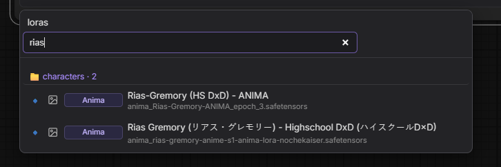

# 1.3.0 — Recursive Add Lora search

Deep search from the current breadcrumb, with hits **grouped by folder**.

## What’s new

- **Empty search** → browse the current folder (unchanged)
- **With text** → recursive search under the current breadcrumb root
  - from `loras/` → search everywhere
  - from e.g. `characters/` → only inside that subtree
- Matches **filename / path / Civitai title / base model**
- Results aggregated under folder headers (`📁 characters · 2`)
- Click a group header to open that folder
- Search query clears on drill-down / breadcrumb

## Soft deps (unchanged)

- Civitai Toolkit — names, covers, base model, `?`
- ComfyUI-Custom-Scripts — `i` (View Lora info)
